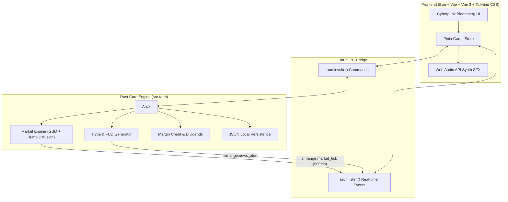

# Simange (Simulation of Exchange)

[](https://www.gnu.org/licenses/gpl-3.0)
[](https://tauri.app)
[](https://bun.sh)
[](https://vuejs.org)
[](https://tailwindcss.com)

**Simange** (Simulation of Exchange) is a Free and Open Source (FOSS) high-frequency financial trading terminal desktop game. Featuring a cyberpunk Bloomberg-style terminal aesthetic, Simange pits players against volatile parody asset markets driven by real-time stochastic random walk models, Poisson jump diffusions, breaking hype/FUD news events, and dynamic order books.

---

## 🚀 Key Features

### 1. Parody Asset System
Trade accurate parodies of top global cryptocurrencies and mega-cap tech stocks:

| Asset Name | Ticker | Category | Parody Of | Characteristics |
| :--- | :---: | :---: | :--- | :--- |
| **Bytecoin** | `BYTE` | Crypto | Bitcoin (BTC) | The pioneer digital store-of-value. High liquidity & macro-correlated. |
| **Aethereum** | `AETH` | Crypto | Ethereum (ETH) | Smart contract powerhouse subject to gas fee spikes & upgrade narratives. |
| **Solona** | `SOLA` | Crypto | Solana (SOL) | Ultra-fast Layer 1 with lightning throughput whenever validators stay up. |
| **MeowCoin** | `MEOW` | Crypto | Dogecoin (DOGE) | Feline community meme token subject to massive 800% pump & dump influencer tweets. |
| **USD-Fake** | `USDF` | Crypto | Tether (USDT) | Algorithmic stablecoin anchored at $1.00 with occasional mild depeg events. |
| **Pear Inc.** | `PEAR` | Stock | Apple (AAPL) | Consumer hardware & services giant. Stable dividend growth and reliable revenue. |
| **MicroHard** | `MHD` | Stock | Microsoft (MSFT) | Enterprise cloud & office AI juggernaut. Low volatility and consistent buybacks. |
| **MuskCar** | `TSLA-X` | Stock | Tesla (TSLA) | Autonomous EV & humanoid robot maker led by an eccentric memetic CEO. |
| **Nvidiot** | `PIXL` | Stock | Nvidia (NVDA) | GPU silicon monopolizer powering the global artificial intelligence bubble. |

---

### 2. Four Distinct Game Modes

1. **Stock Exchange Mode:**
   - Stable corporate equities (`PEAR`, `MHD`, `TSLA-X`, `PIXL`).
   - Slower macro pace, periodic financial earnings reports, and annualized dividend payouts.
   - Starting Capital: **$25,000**.

2. **Cryptocurrency Mode:**
   - 24/7 high volatility with extreme swings (`BYTE`, `AETH`, `SOLA`, `MEOW`, `USDF`).
   - Real-time "Hype/FUD Feed" driving instant price shocks, liquidation spirals, and short squeezes.
   - Starting Capital: **$10,000**.

3. **Test Mode (Sandbox):**
   - Unlimited starting cash ($100,000,000).
   - All 9 crypto and stock assets active simultaneously.
   - Adjustable simulation time speeds (1x to 5x) for rapid strategy experimentation.

4. **Custom Mode:**
   - Fully customizable starting parameters:
     - Starting Cash ($1,000 – $1,000,000).
     - Volatility Multiplier slider (0.2x – 5.0x).
     - Individual active asset toggles.

---

### 3. Net Worth Rank Ladder

Your rank dynamically unlocks lower trading fees, greater credit lines, and VIP privileges:

| Tier | Net Worth Requirement | Trading Fee | Perks & Privileges |
| :--- | :--- | :---: | :--- |
| **Retail Noob** | `< $15,000` | 0.25% | Baseline entry tier. Small bank credit lines. |
| **Day Trader Kids** | `$15,000 – $50,000` | 0.20% | Unlocks 2x Margin trading and basic technical charts. |
| **Wall Street Wannabe** | `$50,000 – $250,000` | 0.15% | Bank loans up to $100,000; early access to insider rumors. |
| **Market Chad** | `$250,000 – $1,000,000` | 0.08% | VIP Dark Pool execution; high-frequency order placement. |
| **Crypto Whale** | `$1,000,000 – $10,000,000` | 0.04% | Market-moving volume capacity; priority pump alerts. |
| **Wall Street Legend** | `> $10,000,000` | 0.00% | Zero fees; infinite credit lines; Master of Global Markets. |

---

### 4. Technical Architecture



---

## 🛠️ Development & Building

### Prerequisites
- [Bun](https://bun.sh) (v1.0+)
- [Rust](https://rustup.rs) (1.75+ recommended)
- Standard Tauri prerequisites for your OS (C++ build tools on Windows; `libwebkit2gtk-4.1-dev` on Linux)

### Setup & Run
```bash
# 1. Clone repository
git clone https://github.com/username/simange.git
cd simange

# 2. Install dependencies with Bun
bun install

# 3. Launch in desktop development mode (Tauri + Vite)
bun run tauri dev

# Or launch frontend web preview only:
bun run dev
```

### Build Desktop Binaries
```bash
bun run tauri build
```
Compiled installers (`.msi`, `.exe`, `.deb`, `.AppImage`) will be generated under `src-tauri/target/release/bundle/`.

---

## 🤖 Automated CI/CD (GitHub Actions)

Simange includes an automated multi-platform build workflow in `.github/workflows/release.yml`. When a Git tag matching `v*` (e.g., `git tag v0.1.0 && git push origin v0.1.0`) is pushed, GitHub Actions automatically:
1. Installs Bun & Rust toolchains.
2. Builds the Windows (`.msi`, `.exe`) and Linux (`.deb`, `.AppImage`) binaries in parallel.
3. Automatically publishes the assets to GitHub Releases.

---

## 📜 License

Simange is licensed under the **GNU General Public License v3.0 (GPL-3.0)**. See [LICENSE](LICENSE) for the full license text.
